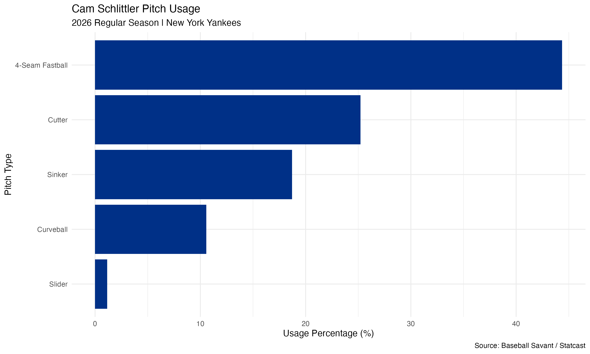
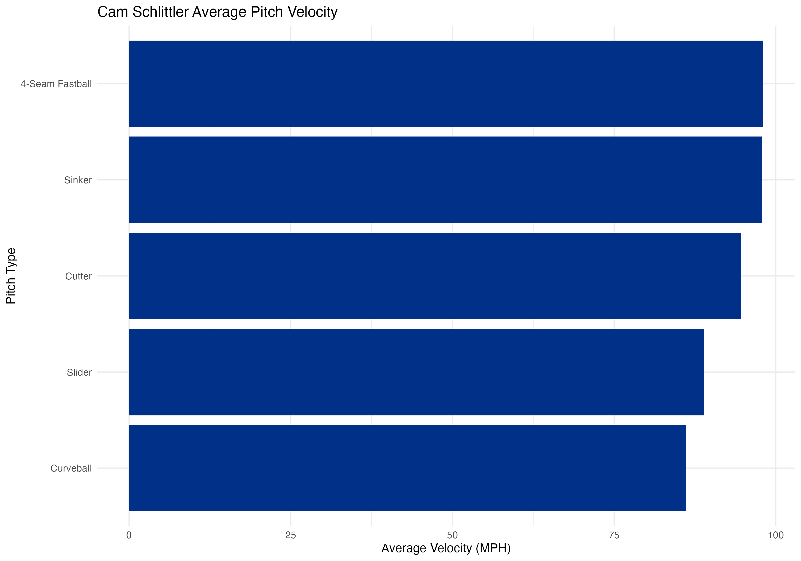
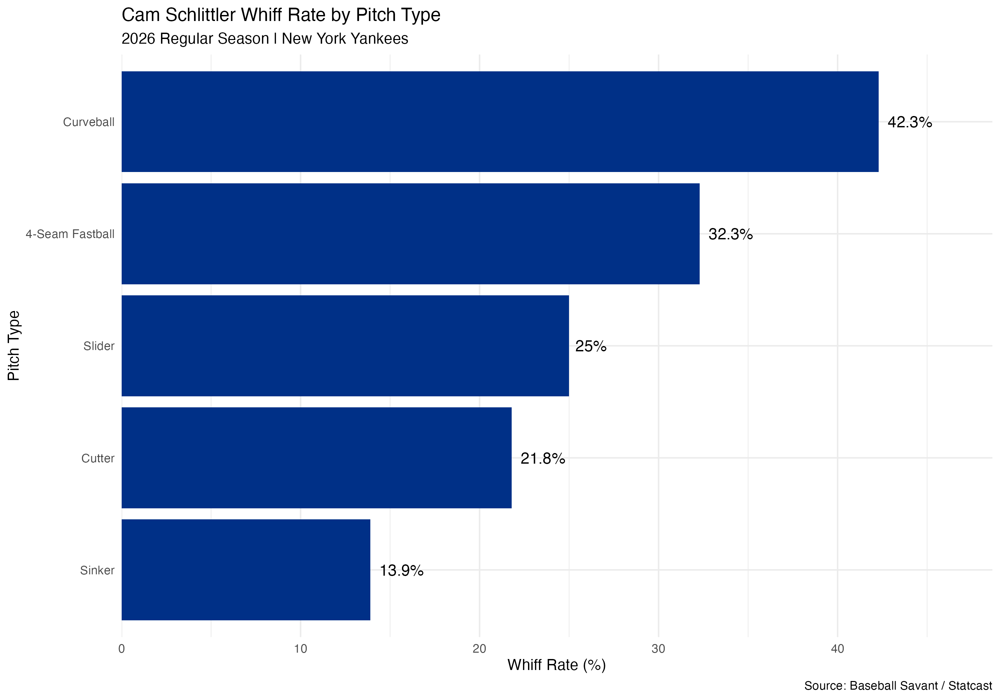
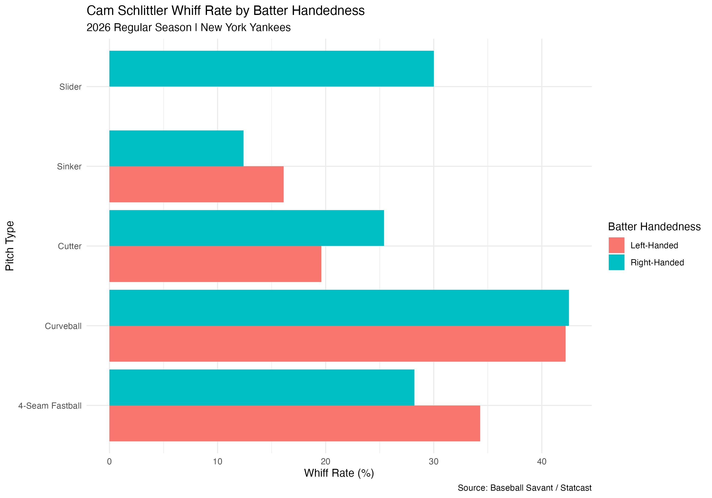
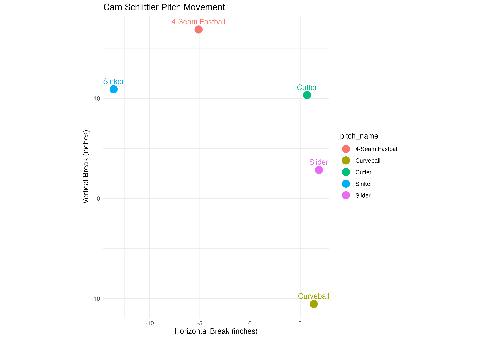
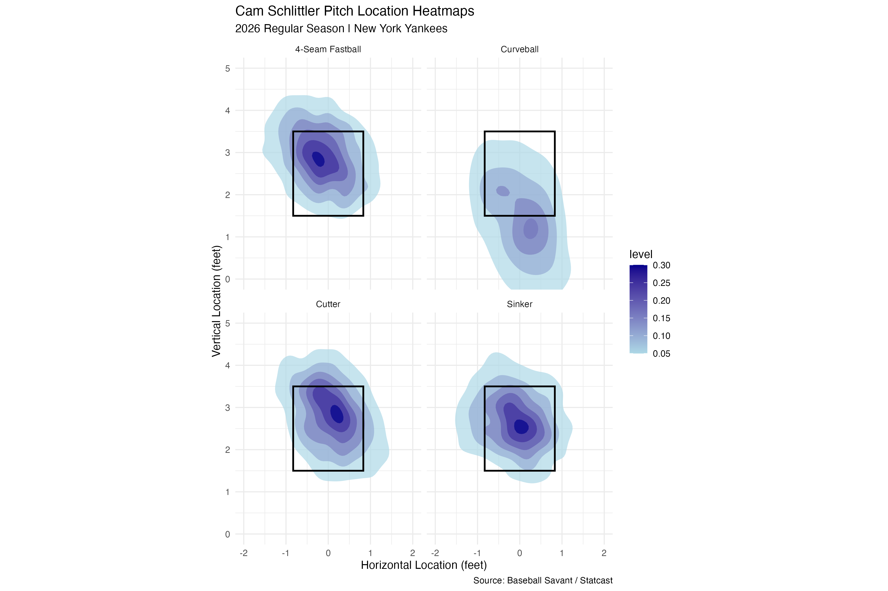
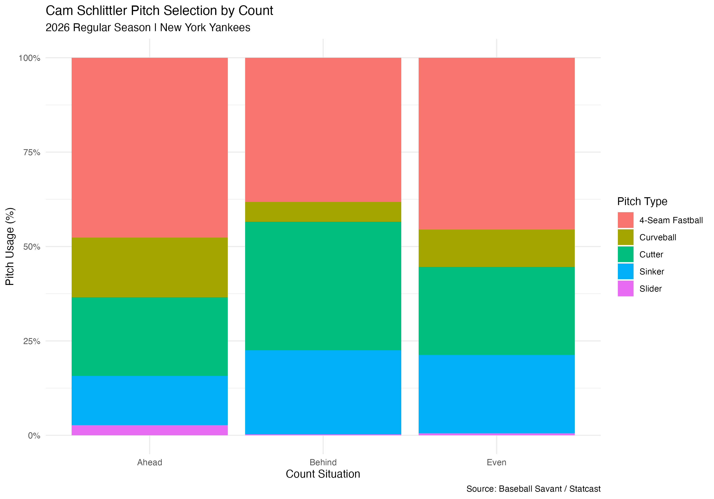

# Cam Schlittler 2026 Pitching Analysis

## Project Overview
This project analyzes Cam Schlittler's 2026 pitching performance with the New York Yankees using Baseball Savant Statcast data and R. The goal was to better understand his pitch arsenal, pitch selection, movement, location, and ability to generate swings and misses.

I used R to clean and organize pitch-level data, calculate pitching metrics, and create visualizations that highlight his strengths and pitching tendencies.

## Tools Used
- R
- tidyverse (dplyr and ggplot2)
- Baseball Savant / Statcast
- RStudio

## Key Findings
- **Pitch Arsenal:** Schlittler primarily relied on his four-seam fastball, cutter, and sinker, with his curveball and slider used less frequently.
- **Whiff Rates:** His curveball generated the highest whiff rate at 42.3%, followed by his four-seam fastball at 32.3%.
- **Pitch Selection:** His pitch mix changed depending on whether he was ahead, behind, or even in the count.
- **Batter Handedness:** His four-seam fastball generated a 34.3% whiff rate against left-handed batters compared with 28.2% against right-handed batters.
- **Pitch Location:** Location heatmaps show how his different pitches were distributed around the strike zone.

## Visualizations

### Pitch Usage

### Average Pitch Velocity

### Whiff Rate by Pitch Type

### Whiff Rate by Batter Handedness

### Pitch Movement

### Pitch Location Heatmaps

### Pitch Selection by Count

## Scouting Report
[View the Full Cam Schlittler Scouting Report (PDF)](Cam_Schlittler_2026_Scouting_Report.pdf)

## R Code
[View the R Analysis Script](Schlittler_2026_Analysis.R)

## Data Source
Baseball Savant / MLB Statcast, 2026 regular season.

## Project Purpose
I created this project to develop my baseball analytics skills and gain experience working with real MLB pitch-level data. It allowed me to practice data cleaning, statistical analysis, data visualization, and communicating baseball insights through R.
